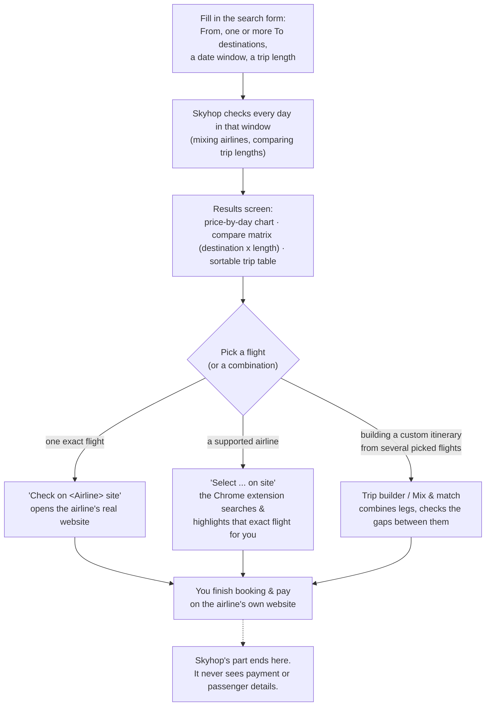
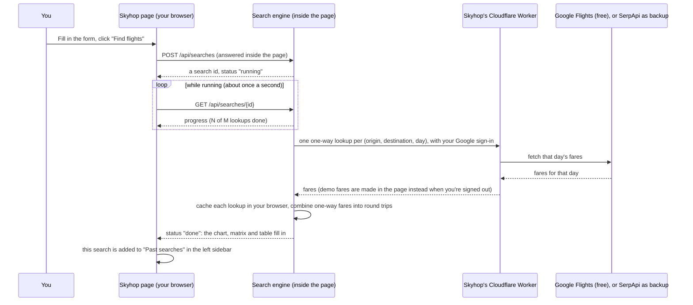
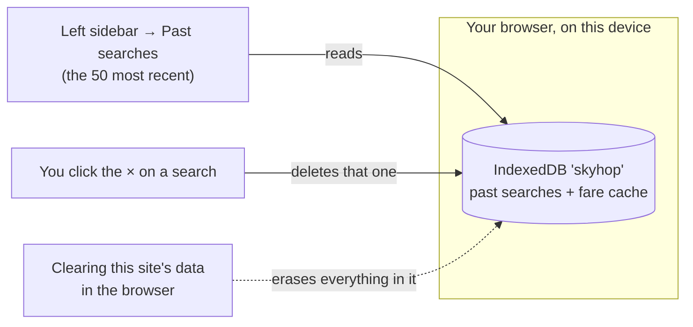

# Flight Agent (Skyhop)

Flexible-date flight search: multi-destination, open-jaw, multi-stop between destinations,
mixed airlines out/back and self-transfer connections. Composes trips from **one-way** offers,
so any provider that can price a one-way flight works.

> **What Skyhop is, in one sentence:** it finds and compares flights across a flexible window of dates,
> destinations and trip lengths, then hands you off to the airline's own website to actually book and pay.
> **Skyhop never books a flight, never takes payment, and never sees your card or passport details.**
> Booking always happens on the airline's own site, in your own browser.

**Open it:** https://alon24.github.io/AiTravelSearcher/ (on a phone too). That site is the only version of Skyhop: there is
nothing to install. It is static files on GitHub Pages, and the search runs inside your browser. It shows **demo fares**
until you press **Sign in** (Google). One sign-in covers the suite: signing in to
[Travel Hub AI](https://alon24.github.io/travel-hub/) or [MyMaps AI](https://alon24.github.io/mymaps-ai/) signs you in
here too, and the other way round. Signed in with an account on the travel apps' user list, searches use real Google
Flights fares. A small Cloudflare Worker fetches them from Google Flights for free, and uses SerpApi credits only if
Google refuses it. The Worker also holds the keys and runs the AI chat, Jev and shared trips; it is set up once as
described in [`worker/README.md`](worker/README.md).

**Chrome extension (desktop):** with the Airline Assist extension ([`browser-extension/`](browser-extension/README.md)),
**Select on site** opens the airline's site and finds your flight. It attaches only to the live site. Jev goes through
the same Worker with your Google sign-in; Laya is a separate local service on `127.0.0.1:8799`. On a phone, airlines
with a known results link get a **Search on <airline> site** button that opens their own search for that flight's
route and day, including links your desktop extension learned.

**Android app:** [`skyhop.apk`](https://github.com/alon24/AiTravelSearcher/releases/download/android-latest/skyhop.apk)
(built from `android/`) loads the live site, with the airline's site in a second tab. There, **Select on site** has Jev
find your flight, as the desktop extension does. Sign-in opens your phone's browser once and comes back to the app.

Until 2026-10-13 Skyhop also ran as a Docker / Python server on your own computer. That version was retired; it is in
git history (see "2026-10-13: one version" in [`docs/DESIGN.md`](docs/DESIGN.md)).

Docs: [`docs/DESIGN.md`](docs/DESIGN.md) architecture, provider contract and a price-verification proposal; [`docs/STITCH_BRIEF.md`](docs/STITCH_BRIEF.md) UI design brief for Google Stitch.

## With Travel Hub

[Travel Hub](https://github.com/alon24/travel-hub) keeps a whole vacation as one Trip. Its **Find flights in Skyhop** button opens
Skyhop with the trip filled in (`?from=TLV&to=LIS&back=OPO&start=…&end=…&nights=3&adults=3&trip=…&hub=…`). Every result card and the
Trip builder then have **✈ Save to Travel Hub**, which sends the picked flights back to that trip (`web/hub.js`; the JSON contract is
pinned by `tests/fixtures/travel-hub-handoff.json`, the same file the hub tests). Skyhop still never books: the hub only keeps the flights.

## Using Skyhop: the full flow

### 1. The big picture



**The one thing to remember:** Skyhop's job stops at "here's the flight, here's the airline's site." Every
purchase happens on the airline's own website, in your own name, with your own payment details — Skyhop is
never in that path.

**On a phone** the form is a four-step wizard (Where, When, Who, Review), and results open on the top picks (cheapest,
best value, fastest, cheapest direct) followed by every trip as a short card you can filter by destination, length and
direct flights. Tap a card for its flights and booking buttons; Back returns to the list. The price chart and Mix &
match are tabs, and a bar at the bottom holds Search, Trips, Days, Ask Skyhop and the Trip builder.

**Lost? Press ?** (top of every screen). It opens Help: a guided tour of the screen you are on, tours of the others
(results, Trip builder, Ask Skyhop) and quick answers. The first visit starts the welcome tour by itself.

**On a computer** the results are three tabs, kept at the top while you scroll: **Trips** (the best picks or the
destination x length comparison, the top three trips in full and the rest as one-line rows you click to open),
**Price by day** (the chart and the selected day) and **Mix & match**.

### 2. What happens when you click "Find flights"



A search that covers many days and destinations can take from a few seconds to a couple of minutes — that's
real lookups running, not a stall. The progress bar shows how many are left, and **Cancel** stops it; fares it already
fetched are kept, so a narrower search right after reuses them.

### 3. Where are my past searches stored?



- **In your browser, on this device.** Past searches and the fare cache live in your browser's storage for the site
  (IndexedDB), not in any account and not in the cloud. Another browser or device has its own list.
- **Kept until you delete them.** Nothing expires automatically. The sidebar lists the 50 most recent; hover a
  search and click the **×** to delete it. Clearing the site's data in your browser wipes them all, and the fare
  cache with them, so the next search fetches everything again. A private window keeps them only until it closes.
- **Keep the tab open while a search runs.** The search runs in the page; a search still running when the tab
  closes shows as interrupted next time.
- **A search result is a snapshot.** Prices can move after you searched; a stale result shows a "flight data
  from … ago, search again to refresh" note if it's more than 30 minutes old.

### 4. Booking one flight, or two, from the same or different airlines

This is the part that trips people up, because Skyhop can compare *any* combination but booking always
happens one airline at a time. Once you've picked flights, work out which of these you're in:


- **Same airline, both directions:** the simplest case. One purchase covers both flights.
- **Different airlines, no connection between the two flights** (e.g. outbound with one carrier, return with
  another, or an open-jaw trip): this is **two entirely separate bookings**. Buy the outbound on its
  airline's site, then separately buy the return on the other airline's site. There is no combined checkout,
  and no protection between the two if one is disrupted.
- **Self-transfer through a hub** (turn on "Allow separate tickets" in More options): every leg is its own
  ticket, on its own airline, at its own price. You must collect and re-check your bag and go through
  security again at the connecting airport — the airlines involved have no idea the other ticket exists, so
  a delay on the first leg is entirely your risk. Skyhop only estimates whether the gap is physically enough
  time (see `docs/DESIGN.md` for the exact minutes used); it can't and doesn't guarantee the connection.

**Where the booking buttons take you**, wherever a flight is shown (the trips table, Mix & match, a trip
card, the Trip builder):
- **"Select `<flight>` on site"** appears only for airlines the Chrome extension knows how to drive (see
  `browser-extension/README.md`). It opens a new tab, searches, and highlights that exact fare for you —
  you still do the actual checkout by hand.
- **"Check on `<Airline>` site"** appears for every airline, always. With the extension, it does the same
  search as above. Without it, it opens the airline's real website (looked up automatically if we don't
  already know it — see `docs/DESIGN.md`, "Check on airline site for every airline") and copies the flight's
  details to your clipboard, so you can paste them into the airline's own search.
- If Skyhop genuinely can't find an airline's website, the button says so plainly ("Couldn't find …'s
  website") instead of guessing or sending you to a search engine.

### 5. Comparing and combining flights before you commit


The **Trip builder** (bottom-right floating button, or the sidebar) is where you assemble a custom itinerary
by hand from flights you've picked. It is *not* saved online: it lives in your browser's local storage, so it
follows this browser on this device, not your Google sign-in.

## Quick start for developers

Everything above describes using the web app. The rest of this file is for working on Skyhop itself. There is no
server to run: the site is the files in `src/flightagent/web/`, and `/api` is answered inside the page by
`web/local/backend.js` (the engine in JavaScript: `engine.js`, `models.js`, `itinerary.js`, `geo.js`, `polling.js`,
providers `gflights.js`, `serpapi.js`, `mock.js`, storage `db.js`). Airline sites, bag notes and city airport groups
are in `src/flightagent/data/config.json`.

```bash
python3 tools/build_pages.py _site                # build the site (a plain copy, no bundler)
python3 -m http.server -d _site 8080              # http://localhost:8080, demo fares
SKYHOP_WORKER_URL=... SKYHOP_GOOGLE_CLIENT_ID=... python3 tools/build_pages.py _site   # with sign-in and real fares

pip install -r requirements-dev.txt               # pytest, pytest-xdist, playwright: only for tests
pytest -n auto                                    # Playwright UI tests against the built site, and the rest
node --test tests/js/                             # the in-page engine
node src/flightagent/web/airport-search.test.js   # typo/alias airport search (buka -> Bucharest)
node src/flightagent/web/hub.test.js              # Travel Hub link
(cd worker && node --test)                        # the Worker
python3 tools/sync_assist_manifest.py --check     # extension manifest matches airlines.json
python3 tools/build_airports.py                   # regenerate web/airports.json and airport_coords.json (OpenFlights + OurAirports + aliases)
```

Every push runs the tests; a push to `main` also publishes the site and deploys the Worker
(`.github/workflows/pages.yml`). One-time setup: Settings → Pages → Source: GitHub Actions, then the Worker steps in
[`worker/README.md`](worker/README.md). See "Hosting on GitHub Pages" in [`docs/DESIGN.md`](docs/DESIGN.md).

## Where fares come from
| Source | When |
|---|---|
| Google Flights, **free** | Signed in with an account on the user list. The Worker fetches the Google Flights page (`GET /gflights`, no key) and the page reads it (`web/local/gflights.js`). The badge says LIVE. |
| SerpApi | Only when Google refuses the Worker for a lookup, or the Worker has no free source. Same Google Flights data, through `GET /serpapi`; one credit per (origin, dest, day), free plan 250 credits/month. |
| Demo fares | Signed out, signed in with an account that isn't on the list, or a build without a Worker. Made up in the page (`web/local/mock.js`) and labelled DEMO DATA. |

Nothing is silent: a lookup the backup answered is listed in the results with Google's reason, and when both fail the
error names both. The Worker keeps each answer in Cloudflare's cache for a while, so the same route and day costs one
lookup for everyone. A guest in a shared trip gets real fares only inside that trip, within its daily allowance.

Scraper notes: the Worker builds Google's `tfs` query itself and the page parses the result: the `fast-flights`
library this started from drops Google's "best flights" block (often the cheapest fares), and since October 2026 Google
answers its untyped airport codes with an empty landing page. City codes (`ROM`, `LON`) work directly. Scraping may
violate Google's terms, can be rate-limited or break when Google changes the page, so keep volume modest.
`tests/fixtures/` holds a real captured payload so a layout change shows up as a failing test, and a daily GitHub
Actions probe (`gflights-probe.yml`) opens an issue when the Worker's scraper stops working.

Amadeus Self-Service was shut down on 2026-07-17 and Kiwi Tequila is invite-only, so neither is implemented. A new
source is a provider object with `oneWay(origin, dest, day, opts)` in `web/local/` (see `engine.js`), plus a Worker
route if it needs a key.

## How the search algorithm works (internals; for the on-screen flow see "Using Skyhop" above)
1. Enumerate (depart, return) pairs inside the window for the nights range.
2. For each pair: round trips, open-jaw (`destinations` x (`destinations` + `return_airports`)),
   and with `connect_destinations` multi-stop `ORIGIN→D1→D2→ORIGIN` with every night split.
3. Collect the distinct one-way (origin, dest, day) lookups, check the call budget
   (`max_api_calls`), fetch concurrently through the browser's fare cache (TTL 6h).
4. Filter each leg (stops, layover min/max, max travel time). Self-transfer bundles two tickets
   through a hub when the gap is at least `self_transfer_buffer_min` minutes (4 h by default).
5. Rank: `effective_cost = price + value_of_time x hours (+ self-transfer penalty)`. Reported per
   departure day as cheapest and best value, plus top-N with segments, deep links and warnings.

## Limits worth knowing
- Every price comes from Google Flights, read either free or through SerpApi. **Check price with a second source** on a
  trip looks its exact flights up again on the other one and says whether it shows the same price (SerpApi costs one
  credit per flight).
- Prices are sums of one-way fares; a genuine round-trip fare from one airline can be cheaper. Each there-and-back
  trip has a "Compare with a round-trip ticket" link that opens Google Flights' round-trip search for the same dates
  and travellers, and **Check round-trip price**, which asks Google for its cheapest return ticket on those dates and
  says how it compares with the two one-ways. With the free Google Flights source each flight also shows the range
  Google says that search usually costs, and Google's fare on a nearby day when that day is cheaper.
- Times shown are local. Durations use the provider's real flight times (mock data ignores time zones).
- "Google Flights" deep links open the exact Google Flights search that priced the fare (same passengers, bags,
  stops and currency); with the free Google Flights source, each flight also shows its aircraft, legroom and
  Google's CO₂ estimate against the route's typical flight. "Check on `<Airline>` site" /
  "Select ... on site" go to the airline's own website (see "Using Skyhop" above) — never a search engine,
  and Skyhop itself never books or takes payment.
- Fares are only what Google Flights shows; some low-cost carriers may be missing.

## Ask Skyhop: the AI chat in the app

Press **✨ Ask Skyhop** (bottom right) and describe the trip in plain words, conditions included: *"Portugal for a week
in late November, direct only, no Ryanair, 2 adults and a 6-year-old"*.
- The chat runs the search itself. It fills the form and shows the results beside the chat, so you can see and tweak
  what it did. Then it tells you the best pick.
- Follow-ups keep your conditions: *"same in December"*, *"add Madrid"*, *"drop the direct-only"*.
- Conversations are remembered on your device. Find them under **Recent chats**.
- **📝 Summarize** turns a conversation into a **trip brief** (what you want, your conditions, the best options found)
  and keeps it on the device. From a brief you can:
  - **Continue** it later in a new chat, for example with new dates. The search is filled back in.
  - **Share** it. The brief includes a link that opens Skyhop with that search filled in.
  - Signed in, **Save to Drive**. It is saved to a "Skyhop trip briefs" folder in your Google
    Drive, so it reaches your other devices.
- With real fares, a search that needs more than 40 paid lookups is confirmed with you first.
- **👥 Share** (signed in) turns the conversation into a **shared trip**: a group chat with an invite
  link.
  - Friends open the link and sign in with Google, any account. They see the whole conversation and its searches,
    and can write to the group. Anyone can press **✨** to ask Skyhop, and its searches and answer are posted for
    everyone.
  - **Open results** on any search runs it on your own screen.
  - **Summarize** saves a brief that everyone in the trip sees.
  - Friends who aren't on the travel apps' user list use the AI and real fares only inside the trip, within a daily allowance
    (60 AI turns and 300 fare lookups per trip per day). A shared link can never run up your bill.
- **🗺 Map it** (signed in) puts a search on a [MyMaps AI](https://alon24.github.io/mymaps-ai/) map:
  home, each destination with its best fare, and a line to each. After a search over a country or several cities,
  Skyhop offers it.
  - Choose a **new map**, or **add** the search as a new layer to a map you already have.
  - Tick **Anyone with the link can view it** so others can open the map without signing in.
  - The map is saved in the "MyMaps AI" folder of your Google Drive and opens in MyMaps AI. In a shared trip, the map
    link is posted for everyone.

The chat needs a Google sign-in. The model call goes through the Worker, which holds the OpenRouter key
(`OPENROUTER_API_KEY`, a Worker secret) and sets the model (`CHAT_MODEL` in `worker/wrangler.toml`). The conversation
and its searches run in your browser; only the model call leaves it.
