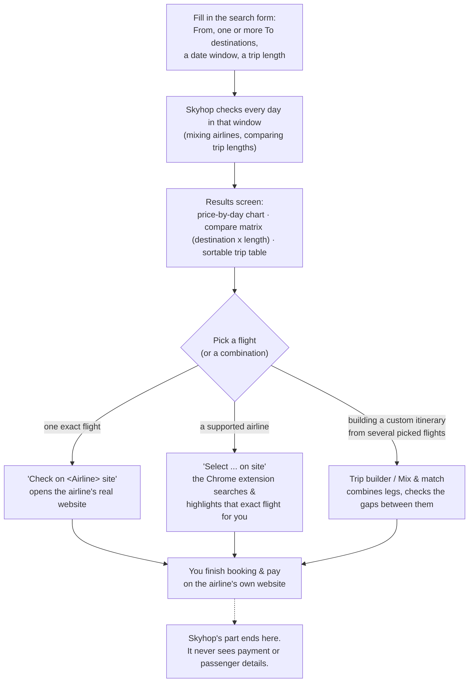
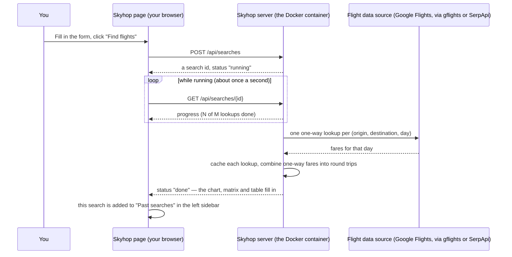
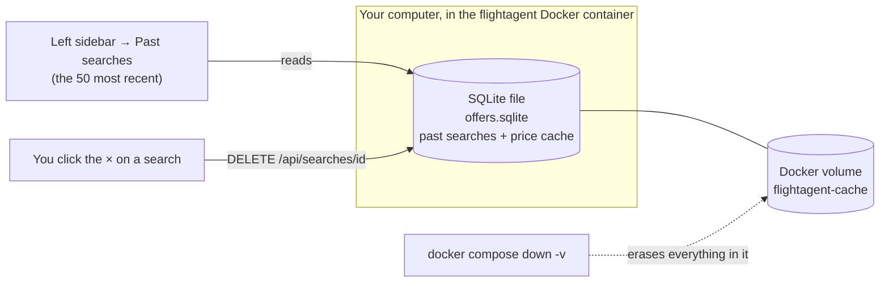
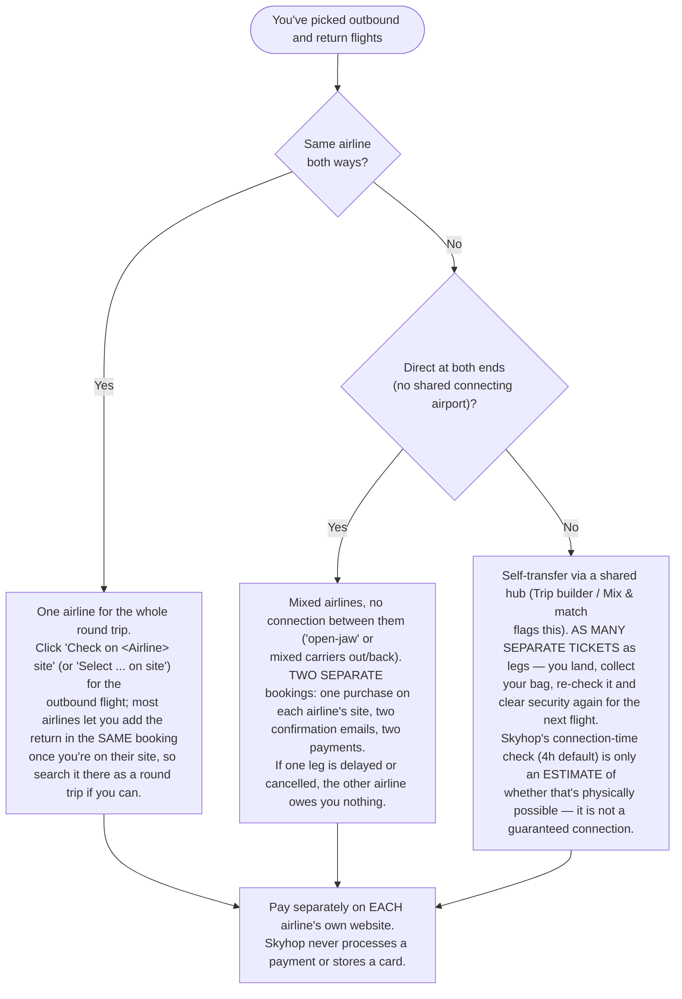
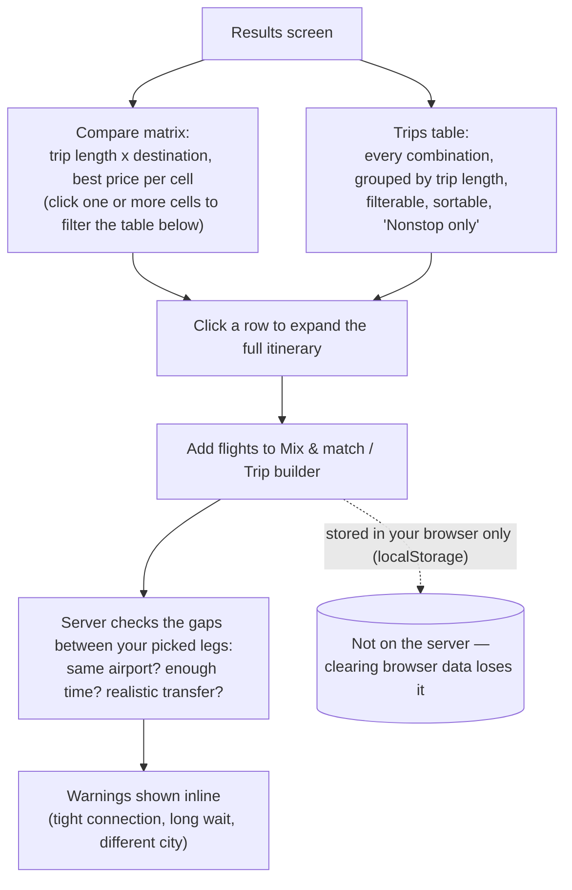

# Flight Agent (Skyhop)

Flexible-date flight search: multi-destination, open-jaw, multi-stop between destinations,
mixed airlines out/back and self-transfer connections. Composes trips from **one-way** offers,
so any provider that can price a one-way flight works.

> **What Skyhop is, in one sentence:** it finds and compares flights across a flexible window of dates,
> destinations and trip lengths, then hands you off to the airline's own website to actually book and pay.
> **Skyhop never books a flight, never takes payment, and never sees your card or passport details.**
> Booking always happens on the airline's own site, in your own browser.

**Web UI:** run `docker compose up -d --build`, then open http://localhost:8765/ (search form, live progress, past searches).
**Installing on another computer (server + Chrome extension): [`docs/INSTALL.md`](docs/INSTALL.md)** (`tools/install.sh` on Linux/macOS).
**Without a server (GitHub Pages):** every push to `main` also publishes a build that runs entirely in the browser
(`.github/workflows/pages.yml`). It shows **demo fares** until you press **Sign in** (Google). One sign-in
covers the suite: signing in to [Travel Hub AI](https://alon24.github.io/travel-hub/) or
[MyMaps AI](https://alon24.github.io/mymaps-ai/) signs you in here too, and the other way round. Once you're signed in,
searches use real Google Flights fares, on phones too. A small Cloudflare Worker fetches them from Google Flights for
free, and uses SerpApi credits only if Google refuses it. The Worker also holds the keys; set it up once as described
in [`worker/README.md`](worker/README.md). With the Airline Assist extension on desktop, Jev works on the web version
too, through the same Worker, so no local server is needed. On a phone, airlines with a known results link get a
**Search on <airline> site** button that opens their own search for that flight's route and day, including links your
desktop extension learned. **Android app:** [`skyhop.apk`](https://github.com/alon24/AiTravelSearcher/releases/download/android-latest/skyhop.apk)
(built from `android/`) is the same site with the airline's site in a second tab. There, **Select on site** has Jev find
your flight, as the desktop extension does. Sign-in opens your phone's browser once and comes back to the app.
One-time setup: Settings → Pages → Source: GitHub Actions. See
"Hosting on GitHub Pages" in [`docs/DESIGN.md`](docs/DESIGN.md).

Docs: [`docs/DESIGN.md`](docs/DESIGN.md) architecture, provider contract and a price-verification proposal; [`docs/STITCH_BRIEF.md`](docs/STITCH_BRIEF.md) UI design brief for Google Stitch.

## With Travel Hub

[Travel Hub](https://github.com/alon24/travel-hub) keeps a whole vacation as one Trip. Its **Find flights in Skyhop** button opens
Skyhop with the trip filled in (`?from=TLV&to=LIS&back=OPO&start=…&end=…&nights=3&adults=3&trip=…&hub=…`). Every result card and the
Trip builder then have **✈ Save to Travel Hub**, which sends the picked flights back to that trip (`web/hub.js`; the JSON contract is
pinned by `tests/fixtures/travel-hub-handoff.json`, the same file the hub tests). Skyhop still never books: the hub only keeps the flights.

## Using Skyhop: the full flow

### 1. The big picture



**The one thing to remember:** Skyhop's job stops at "here's the flight, here's the airline's site." Every
purchase happens on the airline's own website, in your own name, with your own payment details — Skyhop is
never in that path.

### 2. What happens when you click "Find flights"



A search that covers many days and destinations can take from a few seconds to a couple of minutes — that's
real lookups running, not a stall. The progress bar shows how many are left.

### 3. Where are my past searches stored?



- **On this computer only.** Past searches live in the Docker volume on the machine running Skyhop — not in
  any account, not in the cloud, and not shared with another computer unless you copy the volume yourself.
- **Kept until you delete them.** Nothing expires automatically. The sidebar lists the 50 most recent; hover
  a search and click the **×** to delete it, or run `docker compose down -v` to wipe everything at once
  (this also erases the price cache, so the next search re-fetches everything).
- **A search result is a snapshot.** Prices can move after you searched; a stale result shows a "flight data
  from … ago, search again to refresh" note if it's more than 30 minutes old.

### 4. Booking one flight, or two, from the same or different airlines

This is the part that trips people up, because Skyhop can compare *any* combination but booking always
happens one airline at a time. Once you've picked flights, work out which of these you're in:



- **Same airline, both directions:** the simplest case. One purchase covers both flights.
- **Different airlines, no connection between the two flights** (e.g. outbound with one carrier, return with
  another, or an open-jaw trip): this is **two entirely separate bookings**. Buy the outbound on its
  airline's site, then separately buy the return on the other airline's site. There is no combined checkout,
  and no protection between the two if one is disrupted.
- **Self-transfer through a hub** (turn on "Allow separate tickets" in More options): every leg is its own
  ticket, on its own airline, at its own price. You must collect and re-check your bag and go through
  security again at the connecting airport — the airlines involved have no idea the other ticket exists, so
  a delay on the first leg is entirely your risk. Skyhop only estimates whether the gap is physically enough
  time (see `docs/DESIGN.md` for the exact minutes used); it can't and doesn't guarantee the connection.

**Where the booking buttons take you**, wherever a flight is shown (the trips table, Mix & match, a trip
card, the Trip builder):
- **"Select `<flight>` on site"** appears only for airlines the Chrome extension knows how to drive (see
  `browser-extension/README.md`). It opens a new tab, searches, and highlights that exact fare for you —
  you still do the actual checkout by hand.
- **"Check on `<Airline>` site"** appears for every airline, always. With the extension, it does the same
  search as above. Without it, it opens the airline's real website (looked up automatically if we don't
  already know it — see `docs/DESIGN.md`, "Check on airline site for every airline") and copies the flight's
  details to your clipboard, so you can paste them into the airline's own search.
- If Skyhop genuinely can't find an airline's website, the button says so plainly ("Couldn't find …'s
  website") instead of guessing or sending you to a search engine.

### 5. Comparing and combining flights before you commit



The **Trip builder** (bottom-right floating button, or the sidebar) is where you assemble a custom itinerary
by hand from flights you've picked — it is *not* saved on the server: it lives in your browser's local
storage, so it follows this browser on this computer, not your Skyhop account (there is no account).

## Quick start for developers

Everything above describes using the web app. The rest of this file is for working on Skyhop itself.

```bash
python -m venv .venv && .venv/bin/pip install -e '.[dev]'
cp .env.example .env            # FLIGHTAGENT_PROVIDER=mock works offline, no key needed
.venv/bin/flightagent --to ROM,PAR,LON --return-from BRU \
    --from-date 2026-10-01 --to-date 2026-11-15 --nights 4-7 \
    --self-transfer IST,ATH --connect --top 5        # add --json for machine output
.venv/bin/uvicorn flightagent.api:app                 # POST /search, POST /search/report
.venv/bin/pytest
node src/flightagent/web/airport-search.test.js   # typo/alias airport search (buka -> Bucharest)
python tools/build_airports.py                    # regenerate web/airports.json and airport_coords.json (OpenFlights + OurAirports + aliases)
python tools/build_pages.py _site                 # the server-less GitHub Pages build; serve _site/ with any static server
```

## Providers
| name | status |
|---|---|
| `gflights` | **free**, scrapes Google Flights (no key). ~0.5 s per lookup at low concurrency |
| `serpapi` | Google Flights via SerpApi (`SERPAPI_API_KEY`); free plan = 250 credits/month, 1 credit per (origin, dest, day) |
| `mock` | deterministic fake fares, for development / tests |

`FLIGHTAGENT_PROVIDER` accepts a comma list as a fallback order. The default `gflights,serpapi`
scrapes for free and only spends SerpApi credits if Google blocks or breaks the scraper.

Scraper notes: it fetches with `primp`, a browser-impersonating HTTP client, and builds Google's `tfs`
query and parses the page itself: the `fast-flights` library it started from drops Google's "best flights" block
(often the cheapest fares), and since October 2026 Google answers its untyped airport codes with an empty landing
page. It accepts city codes (`ROM`, `LON`) directly. Scraping may violate Google's terms, can be
rate-limited or break when Google changes the page, so keep volume modest. `tests/fixtures/` holds a
real captured payload so a layout change shows up as a failing test.

Amadeus Self-Service was shut down on 2026-07-17 and Kiwi Tequila is invite-only, so neither is
implemented. Add a provider by implementing `FlightProvider.one_way` (`providers/base.py`).

## How the search algorithm works (internals; for the on-screen flow see "Using Skyhop" above)
1. Enumerate (depart, return) pairs inside the window for the nights range.
2. For each pair: round trips, open-jaw (`destinations` x (`destinations` + `return_airports`)),
   and with `--connect` multi-stop `ORIGIN→D1→D2→ORIGIN` with every night split.
3. Collect the distinct one-way (origin, dest, day) lookups, check the call budget
   (`--max-calls`), fetch concurrently through a SQLite cache (TTL 6h).
4. Filter each leg (stops, layover min/max, max travel time). Self-transfer bundles two tickets
   through a hub when the gap is at least `--buffer` hours.
5. Rank: `effective_cost = price + value_of_time x hours (+ self-transfer penalty)`. Reported per
   departure day as cheapest and best value, plus top-N with segments, deep links and warnings.

## Limits worth knowing
- Prices are sums of one-way fares; a genuine round-trip fare from one airline can be cheaper. Each there-and-back
  trip has a "Compare with a round-trip ticket" link that opens Google Flights' round-trip search for the same dates
  and travellers, and with the free Google Flights source each flight shows the range Google says that search
  usually costs.
- Times shown are local. Durations use the provider's real flight times (mock data ignores time zones).
- "Google Flights" deep links open the exact Google Flights search that priced the fare (same passengers, bags,
  stops and currency); with the free Google Flights source, each flight also shows its aircraft, legroom and
  Google's CO₂ estimate against the route's typical flight. "Check on `<Airline>` site" /
  "Select ... on site" go to the airline's own website (see "Using Skyhop" above) — never a search engine,
  and Skyhop itself never books or takes payment.
- Providers return only what Google Flights shows; some low-cost carriers may be missing.

## Ask Skyhop: the AI chat in the app

Press **✨ Ask Skyhop** (bottom right) and describe the trip in plain words, conditions included: *"Portugal for a week
in late November, direct only, no Ryanair, 2 adults and a 6-year-old"*.
- The chat runs the search itself. It fills the form and shows the results beside the chat, so you can see and tweak
  what it did. Then it tells you the best pick.
- Follow-ups keep your conditions: *"same in December"*, *"add Madrid"*, *"drop the direct-only"*.
- Conversations are remembered on your device. Find them under **Recent chats**.
- **📝 Summarize** turns a conversation into a **trip brief** (what you want, your conditions, the best options found)
  and keeps it on the device. From a brief you can:
  - **Continue** it later in a new chat, for example with new dates. The search is filled back in.
  - **Share** it. The brief includes a link that opens Skyhop with that search filled in.
  - On the web version, signed in, **Save to Drive**. It is saved to a "Skyhop trip briefs" folder in your Google
    Drive, so it reaches your other devices.
- With real fares, a search that needs more than 40 paid lookups is confirmed with you first.
- **👥 Share** (web version, signed in) turns the conversation into a **shared trip**: a group chat with an invite
  link.
  - Friends open the link and sign in with Google, any account. They see the whole conversation and its searches,
    and can write to the group. Anyone can press **✨** to ask Skyhop, and its searches and answer are posted for
    everyone.
  - **Open results** on any search runs it on your own screen.
  - **Summarize** saves a brief that everyone in the trip sees.
  - Friends who aren't on `ALLOWED_EMAILS` use the AI and real fares only inside the trip, within a daily allowance
    (60 AI turns and 300 fare lookups per trip per day). A shared link can never run up your bill.
- **🗺 Map it** (web version, signed in) puts a search on a [MyMaps AI](https://alon24.github.io/mymaps-ai/) map:
  home, each destination with its best fare, and a line to each. After a search over a country or several cities,
  Skyhop offers it.
  - Choose a **new map**, or **add** the search as a new layer to a map you already have.
  - Tick **Anyone with the link can view it** so others can open the map without signing in.
  - The map is saved in the "MyMaps AI" folder of your Google Drive and opens in MyMaps AI. In a shared trip, the map
    link is posted for everyone.

The model call needs an OpenRouter key: `OPENROUTER_API_KEY` in `.env` for Docker, or the Worker's secret on the web
version. The model is set with `FLIGHTAGENT_CHAT_MODEL` (Worker: `CHAT_MODEL`).

## Natural-language chat (built in, no n8n)

Skyhop used to have this as an n8n workflow calling `POST /search/simple`; that external chat app has been
removed and the same job is now done by the service itself (`src/flightagent/chat.py`), one call to a chat
model to turn your sentence into search parameters, then the same deterministic search everything else uses.

```bash
flightagent-chat                              # a REPL on the command line
curl -X POST localhost:8765/api/chat -H 'content-type: application/json' \
     -d '{"message": "cheapest 5 nights in Rome, Paris or London, October"}'
```

Needs `OPENROUTER_API_KEY` (or `OPENROUTER_KEY`) in `.env` — the same account used for the Jev model (see
`docs/DESIGN.md`). Model: `FLIGHTAGENT_CHAT_MODEL` (default `openai/gpt-4o-mini`). Pass back the response's
`session_id` to continue the same conversation; it asks one short question if a required detail (dates,
destinations, trip length) is missing, otherwise runs the search and summarises the report. Conversations
live in memory only (lost on a restart) and are capped so a long-running server can't grow unbounded.

Set `FLIGHTAGENT_PROVIDER=gflights,serpapi` in `.env` (then `docker compose up -d --build`) for real prices;
with `mock` every report is labelled DEMO DATA. `GET /health` shows the active provider.
