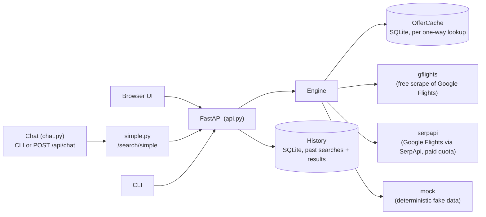

# Skyhop / Flight Agent: Design

Status: implemented except section 8 (price verification), which is a proposal.
Audience: a maintainer, a reviewer, or anyone plugging in a **third-party flight-data provider**.

## 1. Goal

Given an origin, one or more destinations, a date window and a trip length, find the cheapest
(and best value) trips. The engine supports round trips, open-jaw, multi-stop between destinations,
mixed airlines, self-transfer connections and layover/duration limits. Output is JSON for machines and a
readable report or web UI for people.

Non-goals: booking, payment, fare rules, baggage pricing, seat selection.

## 2. Architecture



- **One Python service** (`src/flightagent/`), one Docker container. The web UI is static files served by
  the same service (`web/`, no build step).
- **The natural-language chat is built in, not a separate app** (`chat.py`, `POST /api/chat` or the
  `flightagent-chat` CLI): one call to a chat model turns a sentence into search parameters (the same flat
  shape `simple.py`'s `SimpleSearch` already defined for `/search/simple`), then the same deterministic
  Python does the actual search. There used to be an n8n workflow doing this externally
  (`n8n/flight-agent-chat.json`, Chat Trigger → AI Agent → HTTP tool → `POST /search/simple`); it has been
  removed in favour of this, and the service no longer depends on an external `n8n_default` Docker network.
- **Everything is composed from one-way lookups**: `(origin, destination, day) -> offers`. Round trips,
  open-jaw, mixed airlines and self-transfer are built by combining one-way offers. That is why any
  provider that can price a one-way flight can be plugged in.

### Hosting on GitHub Pages (Oct 2026)

The goal is to run Skyhop like `alon24/mymaps-ai`: static files on GitHub Pages, a small Cloudflare Worker for the
secrets, nothing on the user's machine. Stages, each its own PR, with the Docker service working throughout:

1. **The engine runs in the page (this stage).** `web/local/*.js` is a line-for-line port of `engine.py`, `models.py`,
   `itinerary.py`, `geo.py`, `polling.py`, `airline_sites.py` and the mock provider, plus `backend.js`, which answers the
   same `/api` routes as `api.py` inside the page. `app.js`'s `api()` hands requests to it when `runtime.js` says
   `backend: "browser"`; `tools/build_pages.py` writes that `runtime.js` and the data the server would send
   (`config.json` from `links.py`, `local/airport_tz.json`). History, the offer cache and airline-site answers live in
   IndexedDB (`local/db.js`). Airline websites come straight from Wikidata, which answers browsers. Fares are the mock
   provider's, number for number (`local/rng.js` reproduces Python's Mersenne Twister and seeding).
   - Kept honest by `tests/test_browser_parity.py` (Python and JS run the same searches, connection checks, request
     validation and site choice; results must be identical) and by running **every UI test twice**, against the
     server and against the Pages build served under a sub-path (`conftest.py`).
   - Not in the browser: the background recheck loop (a recheck runs when the user asks), chat, Jev. A search still
     running when the tab closes is marked failed on the next visit.
2. **Worker (`worker/`):** a Cloudflare Worker holds the SerpApi and OpenRouter keys. Sign-in works like mymaps-ai:
   - The page gets a Google access token (Google Identity Services token client, scope `openid email`,
     `local/account.js`) and sends it as a Bearer header.
   - The Worker asks Google's `tokeninfo` whether the token was issued to our client, and caches the answer for up to
     5 minutes. `ALLOWED_EMAILS` limits who may spend credits.
   - **One sign-in for the suite.** Travel Hub AI (alon24/travel-hub) is on the same origin (`alon24.github.io`) and,
     as checked in its deploy log on 2026-10-11, uses the same Google OAuth client. With no Skyhop session,
     `account.js` uses the hub's `travel-hub.session` (`{token, expires, email}`) if it has over a minute left. A Skyhop
     sign-in is written there when the hub has none; signing out, or the Worker refusing the token, removes the hub's copy
     of that same token (it is revoked or dead). MyMaps AI's token is `drive.file` only, with no email, so it can't be shared.
   - Signed in, `backend.js` swaps the mock provider for real fares, in the server's default order
     (`gflights,serpapi`): `local/gflights.js` first, `local/serpapi.js` when that lookup fails (`fallback()`, as
     `FallbackProvider`). The badge says LIVE.
   - **Nothing silent (ilan, 2026-10-10: "this is money").** A lookup answered by the backup carries why
     (`Offers.fallback`, both engines), and the results warn "N lookup(s) used the backup provider; first: gflights
     failed (…), so serpapi answered". When both fail, the error names both reasons. The estimate says SerpApi credits
     may be spent when Google refuses. The Worker's catch-all error names the failure.
   - **Free fares (`GET /gflights`, `worker/src/gflights.js`).** The Worker builds the same `tfs` query as fast-flights
     (byte for byte, tested from pytest), fetches the Google Flights page with a browser User-Agent and a consent cookie,
     and returns the `ds:1` result groups. The page parses them like `gflights.parse_groups` (parity-tested) and asks
     again for flights listed without a fare, as `gflights.py` does. A robot check or cookie wall is a 502 that names
     it, and the fallback answers from SerpApi. Whether Google answers Cloudflare's addresses isn't measured yet
     (2026-10-10); the GitHub Actions probe got 10/10 answers from a cloud address on 2026-10-09.
   - **SerpApi (`GET /serpapi`).** Parsed exactly like `SerpApiProvider.parse` (parity-tested); one credit a lookup.
   - Offer-cache keys include the provider, so demo and real fares never mix.
   - The token is kept in localStorage until it expires (about 1 h), so a reload or a phone doesn't ask again. A 401
     from the Worker signs the page out and says so.
   - **Jev for the extension.** On the web version the page hands the Airline Assist extension its Worker URL and
     Google token (`skyhop-jev-route` event, `content-bridge.js`), which `background.js` keeps in session storage until
     the token expires and uses for `POST /decide`. Without it, Jev goes to the local server as before. Jev is the
     default there until Laya is picked, since a phone or a laptop without Docker has no Laya.
   - CI (`pages.yml`) bakes `SKYHOP_WORKER_URL` and `SKYHOP_GOOGLE_CLIENT_ID` (GitHub variables) into `runtime.js`.
     When the `CLOUDFLARE_API_TOKEN` secret exists, it also deploys the Worker. Setup steps are in `worker/README.md`.
3. **Ask Skyhop, the AI chat (`web/chat.js`).**
   - **Where things run.** The conversation and its one tool run in the page. Only the model call leaves it, through
     `POST /api/chat/complete` (`chat.complete`, server) or the Worker's `POST /chat` (Pages). Both add the key, fix
     the model and bound a call: at most 80 messages, 80k characters and 4 tools.
   - **The `search_flights` tool.** It takes `SearchRequest` fields. It validates them with the JS port of the
     request model, estimates, and runs the search through the normal `/api/searches` route, so the form fills in and
     the results render as for a typed search. It then hands the model a digest: the top 5 trips, the cheapest per
     destination, and warnings.
   - **Asking before spending.** A live search needing more than 40 lookups returns `needs_confirmation`. The model
     must ask, then pass `confirmed_lookups`.
   - **Storage.** Conversations and briefs are kept in IndexedDB (stores `chats` and `briefs`, DB v2).
   - **Summarize.** A JSON-mode call writes the brief's text; the search request is taken from the last search, not
     from the model.
   - **Drive.** Briefs go to Drive as Markdown with the brief's JSON in a trailing comment (`local/drive.js`, scope
     `drive.file`, asked for on the first "Save to Drive"). They are listed back from Drive on other devices.
   - **Sharing.** `#search=<base64url request>` links open Skyhop with the search filled in.
4. **Shared trips (`web/trip.js`, `worker/src/trips.js`).**
   - **Storage.** Each trip is one Durable Object (SQLite-backed, so it works on the Workers free plan). It holds the
     title, owner, members, brief, last search and numbered messages: people's words, Skyhop's answers, searches as
     args, digest and request, and briefs.
   - **Who can do what.** Only an `ALLOWED_EMAILS` account can start a trip. Any Google account with the link joins
     by reading it.
   - **Guest allowance.** The Worker now tells *allowed* accounts apart from *guests* (`/health` returns `user` or
     `guest`). A guest's `/chat` and `/serpapi` calls are accepted only with an `X-Trip` header, and each one is
     charged to that trip's daily allowance (`spend`: 60 chat turns and 300 lookups per UTC day). So a leaked link
     costs at most that much.
   - **Skyhop's turns.** A turn runs in the browser of whoever pressed ✨. It sees the trip's history with names
     ("dana: …"), runs its searches there, and posts the search cards and the answer for everyone.
   - **Syncing.** Other members pick up new messages by polling `GET /trips/:id?since=` every 4 s while the chat is
     open. Polling was chosen over WebSockets as simpler, and fine for a few people.
5. **MyMaps AI maps (`web/local/mymaps.js`).**
   - **No shared server.** mymaps-ai keeps each map as a JSON file (schema 1: layers of GeoJSON features with
     `name`, `description`, `color`, `icon`) in the "MyMaps AI" Drive folder, tagged `appProperties.app=mymaps-ai`,
     and opens one at `#/m/<fileId>`. Skyhop writes the same files, so no change to mymaps-ai was needed.
   - **Same OAuth client.** The `drive.file` scope only shows an app the files it created. Both apps use one Google
     OAuth client, so each sees the other's maps. With a different client ID, "Add to" would list nothing.
   - **The layer.** Home, each destination with its cheapest fare and best pick, and a line from home to each.
     Positions come from `web/airport_coords.json` (6,088 airports, built by `tools/build_airports.py` from
     OpenFlights; a city code uses its first airport). Adding to a map picks a colour it doesn't use yet.
   - **Sharing.** "Anyone with the link can view" adds a Drive `anyone`/`reader` permission, so others can open the
     map in MyMaps AI.
   - **In the chat.** The map's link is kept with the conversation, or posted to a shared trip as a `map` message.
     The model is told to offer a map after results for a country or several cities.
6. **Phones.** Real fares come from the Worker (above), so a phone needs nothing else. Extensions don't run in phone
   browsers, so there is no Assist there. Instead:
   - **Search links.** When an airline's results page is a known link, the button reads **Search on <airline> site**
     and opens that page for the leg's route and day; the flight is copied for reference. Links come from the
     registry's verified templates (`links.AIRLINE_SEARCH_URLS`, kept equal to `airlines.json` by a test; Wizz Air
     only, 2026-10-10) and from templates the desktop extension learned, which it posts to the Worker's `/links`
     (`worker/src/links.js`, one Durable Object, allowed accounts write, anyone signed in reads).
   - **Otherwise** **Check on <airline> site** opens the airline's own website (looked up when Skyhop doesn't know it)
     and copies the flight to paste into its search.
   - **Why not an iframe** (asked 2026-10-10): a page can't script a frame from another site, and airline booking
     pages generally refuse to be framed. A native app's own web view can, which is the Android option.
7. **The Android app** (`android/`, ilan chose it 2026-10-10 so Jev can pick the flight on a phone). Two web views:
   the Pages site, and the airline's site as a second tab. No extension runs there, so the extension's own
   `background.js` and `content-bridge.js` run *unchanged* in the Skyhop page on `android/web/app-shim.js`, which
   provides the `chrome.*` calls they make (storage, one airline tab, `executeScript`, messages) over the app's Java
   bridge (`MainActivity.java`). `tools/build_android.py` bundles them, with `airlines.json` and the drivers, into
   `assets/skyhop-app.js`, which the app adds as a document-start script for the Pages origin only.
   - **Drivers** run in the airline tab's page (an extension would use an isolated world), each file in its own
     function scope; `airline-bridge.js` gives them `chrome.runtime.sendMessage`. The Skyhop page takes only
     `laya-*` messages from that tab, because the airline's own scripts can reach the bridge too.
   - **Jev only.** Laya is a service on a computer, so the app pins `decider` to `jev`; without a sign-in the
     airline tab says so instead of falling back to a local server.
   - **Sign-in.** Google refuses OAuth inside an app's web view, so `account.js` asks the app
     (`SkyhopNative.signIn`), which opens `?app-sign-in` in the phone's browser. That page signs in with the usual popup and
     hands the token back as `skyhop://signed-in?t=<base64url JSON>`. It accepts only Skyhop's two scope sets. Any app that
     also claims the `skyhop:` scheme could be offered that link; the token is a one-hour access token for
     `openid email` (plus `drive.file` when Drive is used).
   - **Links** that leave the Skyhop site (airline sites, Google Flights) open in the airline tab.
   - **Build.** `.github/workflows/android.yml` builds the APK; on `main` it publishes it as the `android-latest`
     release. Without the signing-key secrets, every build gets a new throwaway key, so an update needs an uninstall.
     The Java side is only compiled there. `tests/test_android_app.py` checks that the calls the scripts make exist in
     `MainActivity.java`, and `tests/test_android_app_ui.py` drives the page side with a stand-in for the Java bridge,
     including Jev finding a flight in the airline tab.
   - **Unverified** (2026-10-10): the app on a real phone, and whether airline sites behave the same in a web view.

8. **Travel Hub link (`web/hub.js`, added 2026-10-10).** [Travel Hub](https://github.com/alon24/travel-hub) keeps a whole
   vacation as one Trip; Skyhop only supplies its flights.
   - **In:** the hub opens `?from&to&back&start&end&nights&adults&children&trip&hub`. `SkyhopHub.fromParams` fills the
     form (exact nights, expert mode), the query is removed so a reload starts clean, and `{trip, hub}` is kept in
     `localStorage["skyhop.hub"]`. The Find flights button is scrolled to the middle and focused, so it is never hidden
     under the floating Trip builder button.
   - **Out:** **Save to Travel Hub** on a result card or in the Trip builder goes to `<hub>#/handoff/<base64url JSON>`
     (`kind: "flights"`, v1). A leg's price is sent only when it is in the trip's currency, and is the total for every
     traveller. `tests/fixtures/travel-hub-handoff.json` pins the JSON; the hub's own tests parse the same file.
   - **`hub` is checked** (`safeHub`): https only, or http on localhost, so a link can't send flights elsewhere by
     accident.

The port found a real bug: Python subtracts two times of the *same* zone as wall-clock times, so a connection across a
clock change (land FCO 01:00, leave CIA 03:00 on the night Rome springs forward) was reported as 2 h instead of 1 h.
`itinerary._gap` now converts to UTC first.

## 3. Data model (`models.py`)

| Type | Meaning |
|---|---|
| `SearchRequest` | Validated input. Codes are upper-cased. `allow_connections=false` forces `max_stops_per_leg=0`. |
| `Segment` | One flight: airline code/name, flight number, origin, destination, local dep/arr time, `duration_min` (real flying time). |
| `Offer` | One purchasable one-way ticket, or a self-transfer bundle (`self_transfer=True`, `hub` set). `price` is the **total for all travellers**, in `currency`. |
| `LegView`, `Trip` | A leg as presented, and a full itinerary (2 legs, or 3 for multi-stop) with total price, stops, travel time, warnings and `effective_cost`. |
| `DailyBest` | For one departure day: the cheapest trip and the best-value trip. |
| `SearchResult` | `daily`, `top`, `api_calls`, `cache_hits`, `sources` (provider -> lookups served), `elapsed_s`, `warnings`. |

Time rules: segment times are **local** to each airport (naive datetimes). Durations use the provider's
real flying minutes plus layovers, because subtracting local times is wrong across time zones.

## 4. Search algorithm (`engine.py`)

1. **Plan shapes.** For every (depart, return) pair in the window with `min..max` nights:
   round trip to each destination, open-jaw (each destination x each of destinations + `return_airports`),
   and with `connect_destinations` multi-stop `O→D1→D2→O` for every night split.
2. **Collect required lookups.** The set of distinct `(origin, dest, day)` keys. With self-transfer,
   add `(O,H,day)`, `(H,D,day)`, `(H,D,day+1)` for each hub `H`.
3. **Budget and estimate.** Uncached lookups above `max_api_calls` raise `BudgetExceeded` before any call.
   `estimate()` returns `{lookups, cached, to_fetch}`.
4. **Fetch.** Concurrently (semaphore 8), through the cache. A failing lookup becomes a warning; if every
   lookup fails the search fails. Empty results are **not cached**.
5. **Per-leg options.** Build self-transfer bundles (gap >= `max(buffer, min_layover)` and <= `max_layover`),
   then filter: stops, every layover within `[min, max]`, total time <= cap. Keep the 6 best per leg by leg cost.
6. **Compose trips.** Legs are independent, so the cheapest trip is the sum of per-leg minima and the best-value
   trip is the sum of per-leg best-value picks. Only "same airline" couples outbound and return and needs a product.
7. **Rank.** `effective_cost = price + value_of_time_per_hour * hours_in_transit (+ self_transfer_penalty)`.
   Lower is better. Daily table = cheapest and best value per departure day; `top` = best N by `effective_cost`.

Warnings are attached to trips: self-transfer (separate tickets, baggage, no protection), layover >= 8 h,
open-jaw ground transport, different airlines out/back.

## 5. Provider contract (`providers/base.py`)

```python
class FlightProvider(Protocol):
    name: str
    async def one_way(self, origin: str, dest: str, day: date, *,
                      currency: str, adults: int, max_stops: int,
                      children: int = 0, infants: int = 0) -> list[Offer]: ...
```

A provider **must**:

1. Return every itinerary the source shows for that route and day, not only "top" ones. (The `fast-flights`
   library silently dropped Google's "best flights" block, which contained the cheapest fares.)
2. Return `[]` when the source says there are no flights, and **raise** on anything else (blocked, timeout,
   quota, layout change, bad credentials). The engine treats an exception as "unknown", not "none".
   Never return `[]` for an error: it hides failures and would be treated as a real answer.
3. Fill `Segment.duration_min` with real flying minutes when the source has it.
4. Return `price` as the total for all travellers (`adults` + `children` + lap `infants`) in the requested
   `currency`, and set `Offer.provider`. Ages are mapped by the engine: under 2 infant, 2-11 child, 12+ adult.
5. Use local departure/arrival times and IATA airport codes in segments.
6. Honour `max_stops` (0 to 3) or tolerate the engine filtering afterwards. The engine re-filters anyway.
7. Cope with **city codes** (`ROM`, `LON`, `PAR`, `NYC`). Either accept them (gflights) or expand them to
   airports (`providers/airports.py`, used by serpapi).
8. Be safe under concurrency: bound its own request rate (gflights: 3 in flight plus a 0.2-0.7 s jitter).

Composition: `FallbackProvider(primary, backup)` uses the backup only when the primary **raises**.
`FLIGHTAGENT_PROVIDER=gflights,serpapi` builds that chain. Results carry `.source` so reports show which provider
served each lookup.

### Adding a provider (checklist)
1. `providers/<name>.py` implementing `one_way`; keep the network code and the pure parser separate.
2. Save a **real captured response** under `tests/fixtures/` and unit-test the parser (see
   `test_gflights_parses_best_and_other_groups`).
3. Register it in `providers/__init__.py::_one`.
4. Compare against an existing provider on the same routes and dates (section 8) before trusting it.
5. Add rate limits, a timeout, and an error message that names the route and day.

### Airline coverage and passengers (measured, Sept 2026)
- The engine searches **routes and days, never airlines**: Google returns every carrier it sells for that route.
  Observed on real queries: Ryanair (FR, RK), Wizz Air (W4/W6), easyJet (U2), Jet2 (LS), JetBlue (B6), Southwest (WN),
  Frontier (F9), Bluebird Airways (BZ), Israir, El Al, Aegean, ITA and more. A carrier is only missing if Google does
  not sell it on that route.
- Prices are **totals for all travellers**. Children are priced by age (under 2 infant, 2-11 child, 12+ adult).
  Some airlines price children like adults; others (e.g. Swiss) charge less.
- **Infants:** fast-flights swaps the wire values for lap and seat infants. Measured against Google, value 3 is a lap
  infant (fare equals the adult-only fare) and 4 an infant with its own seat, so the scraper sends raw values.
  With a lap infant Google returned about half as many itineraries: airlines that do not carry infants are hidden.
- Google lists some flights **without a price**; the parser skips them (a crash here once forced whole route-days onto the paid fallback).
- The cache key is versioned (`v2|`) so a provider-semantics change never serves stale prices.

### Unpriced flights, rechecks and the cache (measured, Sept 2026)
- Google lists some flights **without a fare**. It is intermittent: HiSky (H4236, TLV-OTP) was priced on 8 of 8 fetches,
  then on 0 of 12 half an hour later, and it showed the fare in a real browser. Euroairlines is unpriced every time
  (Google shows "Price unavailable"). So the parser **keeps** unpriced flights (`Offer.priced=False`): they are never
  ranked or counted as fares, but they are listed (results panel, trip builder, report) and counted as "flies here".
- **Cache lifetime is per entry** (`polling.py`): results with unpriced flights expire after 15 min when the flight is
  within 14 days, 1 h to 60 days, 3 h beyond; priced fares expire after 1 h within 2 days and 3 h within 14 days.
  `refresh_unpriced` makes a search ignore cached "no price" entries.
- **Recheck**: `POST /api/searches/{id}/recheck`, plus a background loop (every minute) that re-runs searches whose
  `next_check` is due, on the schedule above, backing off x2 after 4 fruitless rechecks (cap 6 h) and stopping when the
  flight has departed. `FLIGHTAGENT_RECHECK=0` disables the loop.
- **Last seen fare**: the cache remembers the last price per flight (`fares` table), so a flight Google later shows
  without a price is listed as "last seen ₪505, 2h ago" (may be out of date).
- The scraper asks again (twice, 1 s apart) when it sees an unpriced flight. That rarely helps, since the fare comes
  back minutes later, which is what the scheduled recheck is for.

### Airline finder, trip builder, airline filters
- `POST /api/explore`: which airlines fly between an origin and a country's airports (or listed airports). One date for
  every airport, then 2 more dates only for airports with flights. Per airline: airports served, nonstop or not, cheapest fare.
- Trip builder (`web/builder.js`, `GET /api/flights`, `POST /api/itinerary/check`): hand-built legs; `itinerary.py`
  computes gaps with airport time zones, flags tight or impossible connections, and mentions the estimated ground transfer
  between airports of one city (`geo.py`; estimates supplied by us, not measured data).
- Airline include/exclude filters apply after fetching, so changing them costs no lookups.

### Currency display
- A search runs in one currency (the button's value at that time) and results are stored in it. The currency button
  changes the whole screen at once by **converting displayed prices** with `GET /api/rates` (ECB via frankfurter.dev,
  cached 6 h, approximate fallback), so nothing is re-fetched. `money()` in `app.js` is the single place that converts.
- Whenever a price is converted it is labelled: a "Converted from ILS" badge, an "originally ₪194" line on pick cards, trip
  and builder prices, and a **Show original currency** switch. Original amounts are what Google quoted for that search; we cannot
  know the currency an airline itself sells in, so search in a currency to see Google's price for it.

### Baggage (measured, Sept 2026)
- Google's flight data has **no baggage field**. The only signal is the fee Google adds to a fare when you ask for bags
  (`carry_on_bags` / `checked_bags`), which it does only where it has fee data: US carriers (Frontier cabin +$35, Delta and
  American checked +$45-55) and European low-cost (Ryanair cabin +$48). For **Tel Aviv routes it returned no difference at all**.
- So the app never claims a bag is free: a fee is shown as an estimate, a zero as "no estimate", and airlines with a
  well-known base-fare policy (Ryanair, Wizz, easyJet, Frontier, Spirit) get a "bags usually extra" note (`BAG_NOTES`, general
  policy, not per fare). `GET /api/searches/{id}/bagfees` prices a route/day three times (no bag, cabin, checked); `available`
  is false when Google returned no difference anywhere.
- `SearchRequest.carry_on_bags/checked_bags` (form: "Bags included in the price") make Google add those estimates to every fare.
- **Mix & match** (main page, `web/mix.js`): every flight on the selected day and on a chosen return day, from the cache the
  search filled (`GET /api/searches/{id}/flights`), any outbound with any return, with total, gap check and bag info.

### Airline filter (one state, instant)
- The form's Airlines field is the single filter state. The chips under the results header, the airline panel, the Mix & match
  lists and the next "Find flights" all read and write it, so it never gets out of sync.
- Changing it calls `POST /api/searches/{id}/filter`, which recomputes the result **in place** from the flights already saved
  (`stale_ok`: even expired ones), with no lookups, and keeps the same history entry. `SearchResult.data_from` says how old the
  data is; the UI shows "Flight data from 3h ago: Search again to refresh" past 30 minutes.

### Scrape-failure diagnostics (Laya, optional)
- When `gflights` can't find the expected data script (`parse_html`), the original error was one generic message
  ("consent page, block or layout change"). `providers/laya_classify.py` can turn that into a specific reason
  (`consent`, `captcha`, `blocked`, `other`, or "looks like results but the script was missing" for a real layout
  change) by classifying the page's visible text with [Laya](https://huggingface.co/convaiinnovations/laya), a fast
  BERT-style typed-question classifier (not an LLM/chat model). Verified against real Google Flights consent/block
  page text: correctly separated consent (93% probability), block/rate-limit (93%) and a results page.
- **Runs as a separate shared service, not an in-process import.** Laya's runtime (torch + transformers) is
  ~1GB even CPU-only, and duplicating that per project that wants it is wasteful (it once filled this machine's
  disk mid-install). So it lives at `~/laya-service/` (own venv, installed once), a tiny FastAPI wrapper
  (`server.py`) around `agent.predict()` with the model loaded once and kept warm, listening on
  `127.0.0.1:8799`. `laya_classify.py` is a plain `httpx` client -- **no laya/torch dependency in this project
  at all**. Started manually (`~/laya-service/start.sh`); nothing runs in the background otherwise.
- **Off by default, purely diagnostic**: it only runs on this one failure path (not per-offer), never raises, and
  falls back to the original generic message if disabled, the service isn't running, or anything errors. Enable
  with `FLIGHTAGENT_LAYA=1` (service must already be started); point at a non-default host with
  `FLIGHTAGENT_LAYA_URL`.
- The service defaults to CPU (`LAYA_DEVICE=cpu` env var on the service, not this project) since the call volume
  here doesn't justify GPU setup. For local GPU use: set `USE_TF=0` (avoids a TensorFlow-probe deadlock in
  `laya.load()` if TensorFlow is also installed), and on older NVIDIA cards (Pascal/GTX 10-series, `sm_61`) the
  default PyTorch CUDA wheel has no kernels for them and silently falls back to CPU -- fix by installing a pinned
  CUDA build *before* installing `laya` (installing torch first means `laya`'s own install sees the requirement
  already satisfied and won't overwrite it with a CUDA-mismatched or bigger build), e.g.
  `pip install torch --index-url https://download.pytorch.org/whl/cu126` then `pip install laya`.
- Not used for browsing to airline sites directly (fetching real fares/baggage from the carrier's own site) --
  that would need actual browser automation (Playwright or similar) per airline, which is a separate, larger
  piece of work than this diagnostic classifier. See below.

### Airline-site verification (El Al) -- backend built, currently blocked

- `providers/elal_verify.py`: Playwright script that searches El Al's own site for a specific
  route/date and reads the real per-fare-tier price and baggage text (not Google's estimate).
  On-demand only (never part of a normal search); real selectors captured against the live site
  2026-09-23, documented as fragile in the module docstring (no `data-testid` anywhere on the
  site -- everything is a CSS class name or text match).
- **Blocked in practice**: El Al runs a dedicated third-party anti-bot vendor (seen in its network
  requests: `securitytrfx.com`, posting to a `.../blob/farenet/...` endpoint) that silently
  doesn't render the search widget for an automated browser. Basic fingerprint masking
  (`navigator.webdriver`, UA string -- confirmed with the user before trying, see chat history)
  did **not** get past it. Going further (canvas/WebGL fingerprint spoofing, synthetic input
  timing, etc.) would mean actively engineering to defeat a commercial bot-detection product,
  which this project does not do. Calling the module today mostly returns `status="blocked"`.
- **What does work**: a real, extension-driven browser tab is not caught by the same detection
  (confirmed live -- see `browser-extension/`). That's the shipped path for "land on this exact
  flight so I can buy it"; the Playwright module stays as a second, currently-blocked attempt at
  a backend-only version, kept in case El Al's detection changes or a verifier provider (§5) is
  wanted later.

### Browser extension (`browser-extension/`) -- built and verified end-to-end

Lets a flight row in the web UI open a new tab on the airline's own site with that flight
searched and selected, for the person to finish booking themselves -- no payment or passenger
data ever touches this app. Architecture: a content script (`content-bridge.js`) marks the page
and relays a custom DOM event to a background service worker, which opens a tab and injects a
per-airline driver script (`drivers/elal.js`, plain DOM automation, same selectors as
`elal_verify.py`). Optional: `EXTENSION_DRIVERS` in `app.js` gates the button so it simply
doesn't render without the extension installed. See `browser-extension/README.md` for load/test
instructions. Only El Al wired up.
- **Fixed after first real test**: the background service worker's message listener used to
  `await` the entire tab-load + script-injection sequence before calling `sendResponse` -- MV3
  service workers can be killed mid-wait before that ever happens, surfacing as "message channel
  closed before a response was received" and the tab silently never opening. Fix: respond
  immediately on receipt, let the automation continue independently (the new tab's own status
  banner reports progress/errors directly, nothing needs to wait on the background script).
- Chrome's newer per-site permission model defaults a fresh unpacked extension's host permissions
  to **off** until granted in `chrome://extensions` -> the extension card -> "Site access" --
  declarative `content_scripts` (the Skyhop-page marker) are auto-granted, but `chrome.scripting
  .executeScript` (the actual driver injection into the airline's tab) is not. Toggle on
  `https://www.elal.com/*` and `https://booking.elal.com/*` there if a fresh install doesn't work.

### Wizz Air (W6): elements located on the fly with Laya (Sept 2026, measured 2026-09-25)

Goal: support an airline without writing a per-site script in advance -- find the page's elements at run time
with Laya. Laya is a typed-question classifier (`choice` / `score` / `noul`), not an LLM: it can rank "is this
element <role>?" and classify a page, but it cannot read a price, write a selector or click. So the split is
**Laya locates and classifies, plain code reads numbers and verifies**.

**What was measured**
- *Direct URL:* `wizzair.com/en-gb/booking/select-flight/<from>/<to>/<date>/null/1/0/0/null` renders results in a
  real Chrome tab with no form to drive (same idea as TAROM). Cards show times and two prices but **no flight
  number**, so the flight is matched by departure time (`departTime`, now passed by the web app).
- *Laya accuracy for picking elements:* a single `choice` question over N candidates was unreliable (it picked
  "Sign in" for "accept cookies", and 2/4 tasks wrong on a clean list) and only fits ~192 tokens of options.
  **One `noul` ("is this page element <role>?") per candidate** is much better: on the real Wizz labels
  "Deny all" scored 0.83 for "declines optional cookies" vs 0.01 for "Accept all", and the fare `SELECT` button
  0.79. Margins are still thin (a "Sign in" link once outscored "Search"; "Find Booking" scored 0.80 as a
  fare button), so `laya-agent.js` never trusts the top score alone: minimum score, a veto on labels that could
  leave the flow or spend money, best-3-in-order, and a `verify()` after every click.
- *Cookie banner:* Usercentrics, inside an **open shadow root** -- invisible to `document.querySelectorAll`, so the
  candidate finder pierces shadow roots.

**Options built, for comparison**
| | Extension + Laya (`drivers/results.js`, `drivers/laya-agent.js`) | Playwright + Laya (`providers/wizzair_verify.py`) |
|---|---|---|
| Runs in | your real Chrome tab | headless Chromium on the server |
| Result | works: cookie banner declined, flight matched by time, cheapest fare outlined (verified end to end in the packaged extension with the real Laya service: TLV->FCO 23 Oct, W46044 19:40, cheapest fare outlined) | `status="blocked"`: HTTP 405 + a "Human Verification" page; Laya classifies it "blocked" |
| Bot check | not triggered | triggered; **not** bypassed -- no fingerprint masking (nothing was agreed for Wizz Air, unlike El Al above) |
| Needs | Laya service running (`~/laya-service/start.sh`) | `flightagent[verify]`, Laya optional |
| Laya's role | cookie button, fare-button check, page-type when no cards | page-type only |

Not built: a form-driving variant (typing origin/destination, calendar). The direct URL makes it strictly more
fragile (dates and airport suggestions are numbers/codes, where a classifier is weakest) for no gain on one-way
TLV-origin searches. The extension's Laya calls go through `background.js` (a service worker may fetch
`127.0.0.1:8799`; the airline page may not).

### Airline registry, generic driver and learning (Sept 2026, TLV airlines first)

`browser-extension/airlines.json` lists the airlines Assist knows (66 that fly, or recently flew, out of TLV; a US / Europe /
Asia expansion is planned next). Codes, names and domains are from general knowledge and **only Wizz Air is verified**;
El Al and TAROM are bespoke drivers. Per airline `mode` says how to open a search:
- `url` -- results page is a URL template (`{origin} {dest} {date}` / `{date:DD/MM/YYYY}`), read by the generic
  `drivers/results.js` (cards found by shape, Laya for the cookie/fare buttons and page type). No airline code.
- `discover` -- template unknown (the default): the first click opens the airline's home page and **learns the template
  from one search you do by hand** (`discover()` in `background.js`). The learned URL is stored in `chrome.storage.local`
  with airport codes and date turned into placeholders, then that airline works like a `url` one. A URL carrying a
  long opaque value (session token) is refused -- that airline needs a form-driving driver. Airlines whose site uses
  another airport code than IATA (city codes, internal ids) can't be learned either; they stay `discover`.
- The web app no longer keeps its own list: `content-bridge.js` publishes the airline codes on the page
  (`data-skyhop-airlines`), so adding an airline is an `airlines.json` entry plus `tools/sync_assist_manifest.py`
  (regenerates `host_permissions`; `tests/test_assist_registry.py` fails if they drift).
- Learned end to end on Tus Air (U8): the address `booking.tusairways.com/flight-results/TLV-FCO/2026-10-02/NA/1/0/0` gave the
  template. Its "Select" is a `<span>` in a `<div>` in an `<a>`, not a `<button>`, so `results.js` treats anything with a
  pointer cursor and a short label as a control. **Laya is weak at "which control selects a fare"**: it scored `strong "Price
  per person"` 0.93 and `<div>Select</div>` 0.31 (0.88 once described as `button "Select"`), so the code first narrows to
  controls whose label has a select-type word (Select/Choose/Book/...) and Laya only confirms among them (>= 0.5; >= 0.85
  when no control has such a word). Laya is reliable for the cookie decline button and the page type, less so here.
- Learned on Israir (6H) via the **city code** (`"cityCode":"ROM"` for FCO). Its address also carries internal ids
  (`"ltravelid":2135`), so a template with a run of 4+ digits left after the placeholders is remembered **per destination**
  only (`learned[airline].byDest`), never replayed for other routes (it would silently search the wrong city); a
  destination-independent one is `generic`. Israir's fare box is Hebrew ("בחירה" = choose), so the select-word list
  includes Hebrew and a few European languages.
- Tried and inconclusive: Ryanair's results URL opens the right search but its flights never loaded in a tool-driven tab.
- Languages: `drivers/parse.js` (shared, unit-tested) reads Arabic-Indic/Persian digits, prices with the symbol before or after
  and comma/point decimals ("113,24 €", "1.234,56 €", "7 500 ₽", "45,99 lei"), and knows the word for "select" in English,
  French, German, Romanian, Russian, Arabic, Hebrew, Spanish, Italian and Turkish. The learn-once banner also asks to switch
  the site to English first, so what the page shows is usually English. Not done: rewriting a learned URL's language
  segment to `en` (a guess that could 404 on sites without that locale).
- Times: 24-hour and 12-hour ("2:30 PM", "2:30pm", "2:30 p.m.") both come back as 24-hour "HH:MM" so they match Skyhop's departure
  time; a one-digit hour with no AM/PM ("3:55", a duration) is ignored. Arabic AM/PM markers (ص/م) are not handled.
- Known gaps: a card layout that isn't
  "times + price + button in one block".

### Jev as an alternative decision model (Sept 2026, measured 2026-09-26)

Jev (`typesafe/jev-1.13`, alias `~typesafe/jev-latest`) is TypeSafe's hosted "System One" model on OpenRouter: the same
typed questions as Laya (choice / noul / score, `state` + `questions` -> probabilities), $0.042 per million input tokens,
output free, 32k context, `POST https://openrouter.ai/api/alpha/decisions`. `src/flightagent/decide.py` adapts our
Laya-style requests (wraps a string state, spells out noul true/false criteria) so **callers don't care which answers**.
- **Key stays on the server** (Jev's docs: never in browser code): the extension calls this app's `POST /api/decide`, which
  needs an `X-Skyhop: 1` header (a plain web page can't send it cross-origin, so it can't make the browser spend the key),
  bounds each call (12k chars of state, 8 questions) and sums `usage.cost` (`GET /api/decide/health`). Key: `OPENROUTER_API_KEY`
  or `OPENROUTER_KEY` in `.env`; model: `FLIGHTAGENT_JEV_MODEL`.
- **Switch:** the "🧠 Laya / 🧠 Jev" badge in the Skyhop header (shown when the extension is attached) -> stored in
  `chrome.storage.local`; `FLIGHTAGENT_DECIDER=jev` does the same for the Python-side diagnostics (`laya_classify.py`).
- **Measured on the cases Laya struggled with** (per-candidate noul, same wording): fare button -- Laya scored `Price per person`
  0.93 vs Jev 0.12, `Sign in` for "submit the search" 0.90 vs Jev 0.03; cookie decline -- Deny all 0.94 vs Accept all 0.03
  (Laya 0.83 / 0.01). Jev picks "Select" 0.78 and `€ 113.24` 0.65 (a price box). ~0.36 s per call (network) and about
  $0.000014 per call, i.e. ~$0.00029 for the 21 calls of that test. Laya remains free and offline; Jev needs internet + a key.
- The select-word narrowing in `results.js` stays for both: cheap, and it makes a wrong pick need two independent mistakes.

### Trip length: simple and expert mode (Sept 2026)

The form's trip length has three modes, kept in `lenMode` (saved with the form draft; searches restored from history are mapped
by `inferLenMode`): **any** (default, the whole timeframe: every length from 1 night up to what the dates allow, capped at 60),
and, under the **Expert mode** switch, **exactly N** or **between N and M** (in nights or days; the API always gets nights).
Validation runs on every date or length change (`constrainLength`): both numbers stay within what the dates allow (with a visible
note, "Your dates allow at most ..."), the second number can never be lower than the first (it is raised to match; raising the
first above the second pushes the second up), and expert mode remembers its last numbers when switched off and on.
`tests/test_trip_length_ui.py` drives the real page for all of this. Fixed on the way: switching Nights/Days did not re-write
the numbers (the radio's `input` event set `unit` before the `change` handler converted them), so the inputs now track their own
unit (`inputsUnit`).

### Results screen ported from the Stitch design (Sept 2026)

Design: `docs/stitch/DESIGN.md` ("Results screen rules"). What changed in the app:
- **Server:** `SearchResult.cells` (`BestCell`: cheapest trip per destination x nights, at most 300, sent ordered by nights) so the page can
  show every trip length and destination, not one "cheapest".
- **`web/compare.js`:** the trip-length x destination matrix (heat-tinted cells, multi-select to filter, nothing pre-selected, one "lowest"
  badge) and the trips table **grouped by trip length** (a band per length, every destination under it, cheapest of each band emphasised)
  with multi-select destination/length filters, group-by, "Best per destination and length" vs "Cheapest each day", sort, nonstop
  switch and a row that opens the full trip. Open-jaw / multi-city combinations are hidden by default behind a switch (they would add up
  to six extra columns), but the matrix's "best" column always considers them. More than 12 trip lengths: the 12 cheapest are shown.
  A search with a single destination and length keeps the old three picks. Searches saved before `cells` existed also do.
- **Sticky airline bar:** two rows (search summary + Edit search, then every airline chip; chips wrap, never clip), solid, pinned.
- **Airline names** are weight 800 (15px) in the table, Mix & match and trip cards; **"Check on <airline> site"** is a 44px bordered
  button (also in Mix & match rows next to "Select on site").
- **Full screen:** the `max-width: 1480px` column on `main` is gone.
- Tests: `tests/test_results_compare_ui.py` (drives the real page), `tests/test_engine.py` (cells), shared fixtures in `tests/conftest.py`.
- **Search form** (same design): From/To, then ONE row of five aligned fields (earliest departure, latest return, trip length with its
  Nights/Days switch, stops, currency), then adults and children, "More options", the estimate and "Find flights". Labels never wrap, and the row
  drops to 3 then 2 columns on narrower windows. A fresh page in simple mode no longer shows the false "length was set to fit" note.
- **Airline names**: one rule everywhere (`airlineName()` in app.js): the provider's label, unless our own list spells the same name out in full
  ("ITA" becomes "ITA Airways"; "Israir Airlines" stays).
- Not done yet: mobile.

### "Check on <airline> site" for every airline (Sept 2026)

Every airline gets the button, in the trips table, Mix & match, trip cards, the Trip builder and the unpriced-flights list (`siteButton()` in
`app.js`, one function). It always goes to the airline's own website, never a search engine:
- the extension can search this flight on the airline's site -> it does (English where the driver can choose, e.g. TAROM);
- otherwise the airline's real site opens and the flight's details ("LH5429 TLV → IST, Wed 7 Oct 05:00") are copied to the clipboard, with a
  toast, to paste into the airline's own search (its search can't be driven for airlines outside the extension's list);
- an airline not in our list (`AIRLINE_SITES`, 68 entries) is looked up by `airline_sites.py` via `GET /api/airline-site` (needs the `X-Skyhop`
  header): Wikidata by IATA code (active airlines only) and exact name in ONE query; the label must share a word with the airline's name (a code
  alone is not proof), the address must be https on a public host and must answer; found sites are cached 90 days in `airline_sites.json` next to
  the price cache, real misses 3 days. While it runs the button says "Looking for X's website…"; if none exists it says "Couldn't find X's
  website" (not a link); if the lookup could not be made (Wikidata rate-limits: it answered 429 with Retry-After 1000 s after repeated testing) it
  says "Couldn't check X's website right now. Try again" and is NOT cached as a miss, and the server backs off for the Retry-After time.
- Measured on 2026-09-26: Animawings resolves to animawings.com by name; TAP by code; a made-up airline to "no website".

### The "Select ... on site" auto-search is origin-agnostic (Sept 2026)

Fixed: it only ever showed on the outbound leg, because every call site assumed a search always starts at TLV. `assistFor(code, segments)`
now finds the matching segment REGARDLESS of its origin, and decides purely on what the airline's own driver can do (`anyOrigin`, published by
`background.js`'s `list-airlines` alongside each airline's status): a "url" template or one learned from the user is parameterised by
`{origin}`, so it works from wherever the flight actually leaves; only the two bespoke drivers (El Al, TAROM) stay origin-locked, because
that is THEIR real limit (El Al's own search widget defaults to Tel Aviv; TAROM's direct link hardcodes it) -- not an assumption Skyhop makes.
`selectOnAirlineSite` and `handle()` in background.js now take the real `origin` instead of hardcoding `"TLV"`; a bespoke driver asked for a
different origin refuses with a clear reason instead of silently doing the wrong thing. Applies everywhere the button appears: trip cards
(one per airline in the leg), Mix & match, the compare table.

### Rail/pane redesign (Sept 2026)

The UI was restructured from one long single-column page (full search form on top, every result
section stacked below it) into a master/pane layout: a left rail with three numbered, genuinely
sequential steps -- **1 Trip** (the search form, auto-collapses to a summary once a search runs),
**2 Airlines** (the exclude/only filter, plus the real per-airline list once a search has told us
which airlines exist on the route), **3 Compare** (a live summary, not a form) -- and a right pane
for results, now at a wider `main` max-width since the form no longer duplicates there. Rationale
and full design notes: see the approved plan this was built from (steps, token decisions, what
was deliberately reused vs. new).
- **Per-route "cheapest"**: `res.daily`/`DailyBest` collapses every destination searched into one
  global winner per calendar day (`engine.py::_daily()`, unchanged) -- a real bug behind "cheap
  should be per route, not just cheap". Frontend fix (no backend change): `routePicks()` in
  `app.js` groups `res.top` (already flat, already carries `.destination`) by destination for a
  "Cheapest by route" strip, with `top_n` bumped when multiple destinations are searched. Measured
  real limitation, not a bug: if one destination is cheaper than the others on *every single day*
  in the window, no client-side `top_n` fixes that -- the strip shows an honest explanation instead
  of silently disappearing or showing a misleading single-destination "comparison". Properly fixing
  this needs `_daily()` to group by `(depart_date, destination)`, deferred as a fast-follow.
- **Mix & Match's airline filter unified**: it used to have its own independent, unsynced local
  hide-list (`mix.js`'s old `S.filters.hidden`) alongside the real shared filter -- removed. Found
  and fixed a second, deeper bug while verifying this: `S.q`/`S.row` (and therefore the flight-list
  cache key `lkl()`) only refreshed when the selected *day* changed, not when the shared filter
  changed on the same day -- so Mix & Match could show flights fetched under a stale filter. Fixed
  by refreshing `S.q`/`S.row` on every render and folding the filter's signature into `lkl()`.

### Current providers
| Name | Source | Cost | Notes |
|---|---|---|---|
| `gflights` | Scrapes Google Flights (`fast-flights` HTTP client, own parser) | free | Accepts city codes. May break or be blocked; scraping may violate Google's terms. |
| `serpapi` | SerpApi `engine=google_flights` | 1 credit per lookup; free plan 250/month | Needs `SERPAPI_API_KEY`. City codes are expanded to airport lists. |
| `mock` | Deterministic fake fares | free | UI and reports are labelled DEMO DATA. |

Candidates (research as of Sept 2026, **not verified with our data**): Travelpayouts/Aviasales data API,
FlightAPI.io, Skyscanner via RapidAPI. Not viable: Amadeus Self-Service (shut down 2026-07-17), Kiwi Tequila
(invite-only), Duffel (sellers only).

## 6. API (`api.py`)

| Endpoint | Purpose |
|---|---|
| `POST /search`, `/search/report` | Structured search; JSON or text report. |
| `POST /search/simple` | Flat all-string form for LLM tool calls. Returns `{report}` or `{error}`, never an HTTP error for bad input. |
| `POST /api/estimate` | Lookup count and cache state for a request. |
| `POST /api/searches` | Start a background search, returns `{id}`. 422 if over budget. |
| `GET /api/searches`, `/api/searches/{id}` | History list (light), or one search with progress, request and full result. |
| `DELETE /api/searches/{id}` | Remove from history. |
| `GET /api/config`, `/health` | Active provider chain and airline booking links; liveness. |

Jobs run as asyncio tasks; progress (`done/total` lookups) is written to `History`. Searches still `running`
at startup are marked failed. The cache key is `provider|origin|dest|day|currency|adults|max_stops`, TTL 6 h.

## 7. Configuration

`.env` (loaded by Docker Compose): `FLIGHTAGENT_PROVIDER` (comma list = fallback order), `SERPAPI_API_KEY`,
`FLIGHTAGENT_CACHE_TTL_HOURS`. The compose file pins `FLIGHTAGENT_CACHE_DB=/data/offers.sqlite` so the cache and
`history.sqlite` live on the `flightagent-cache` volume. Never commit `.env`.

## 8. Proposal: price verification by an independent provider

**Problem.** A provider can be wrong in ways we cannot see (a parser bug hid the cheapest fares for the
scraper). A trip shown as "cheapest" is only trustworthy if a second, independent source agrees.
Manually comparing `gflights` and `serpapi` on TLV→FCO (2026-10-05) matched on all shared flights
(9 itineraries, identical prices) only after the parser fix, which is the case for automating this check.

**Design.**
1. New setting `FLIGHTAGENT_VERIFIER=<provider name>` (must differ from the search provider).
2. `verify(trip)` for each leg: call the verifier's `one_way(origin, dest, day)` and find the same flight by
   airline code + flight number + departure time (all segments must match). Do not match on price.
3. Per-leg result `Verification{status, seen_price, delta, provider, checked_at}` with:
   - `confirmed`: found, price within tolerance (default max(3 %, 5 in currency));
   - `price_differs`: found, outside tolerance (show both prices);
   - `not_found`: the verifier does not list that flight (inconclusive, not proof of error);
   - `error`: verifier failed.
4. A trip's overall status is the worst leg status. Only cheap checks run: the top N trips plus the selected day,
   not the whole grid, so cost is about `2 x N` lookups.
5. API: `POST /api/searches/{id}/verify?trip=<index>` (on demand from the UI) storing results in the history row.
6. UI: a badge on each trip card ("Verified by serpapi", "Price differs: $161 vs $175", "Not found"), plus a
   "Verify" button that spends verifier quota only when pressed.
7. Provider conformance test (`tests/provider_contract.py`): for a fixed set of routes and dates, run any new
   provider against a reference provider and report matching rate, price deltas and dropped flights. A new
   provider must reach >= 95 % flight overlap and price agreement within tolerance on the sample before it is enabled.

**Acceptance criteria.**
- With a verifier set, the top 5 trips show a status within one request cycle.
- A deliberately corrupted fixture (price changed by 20 %) is reported as `price_differs`.
- A flight missing from the verifier is `not_found`, never `confirmed`.
- With no verifier configured nothing changes and no extra lookups are made.

## 9. Risks and open questions

- **Scraping fragility and terms.** `gflights` can be blocked or break on a layout change. The fixture test should
  fail loudly, and the fallback chain covers outages but spends quota.
- **Quota.** Free SerpApi = 250 lookups per month; a wide multi-city search needs about 250. The estimate and
  `max_api_calls` protect it. A two-stage search (coarse scan then refine) would cut cost about 3x. Not built.
- **One-way sums.** Round-trip fares from one airline can be cheaper than two one-ways. The engine never sees them.
- **Timezones.** Local times are shown as returned; durations come from the provider.
- **Prices are indicative.** No booking flow: deep links go to Google Flights or airline home pages.
- **Open:** which second provider to verify against (candidates in section 5), and the tolerance rule.

## 10. Reviewer checklist

- [ ] Can a provider return `[]` for an error anywhere? (It must raise.)
- [ ] Are empty results ever cached? (They must not be.)
- [ ] Do durations use real minutes and not local time differences?
- [ ] Do city codes work for every provider on the default path?
- [ ] Is a secret ever logged, stored in history, or committed?
- [ ] Does a failed job always end as `failed` with a readable error?

## 11. Layout

```
src/flightagent/  api.py engine.py models.py history.py cache.py report.py cli.py links.py chat.py simple.py
                  providers/{base,gflights,serpapi,mock,airports}.py   web/{index.html,style.css,app.js,airports.json}
tests/            test_engine.py  fixtures/gflights_tlv_fco_2026-10-05.json
docs/DESIGN.md    this file
```
Airport data: `web/airports.json`, built by `tools/build_airports.py` from OpenFlights (ODbL: names, coordinates, time
zones) and OurAirports (public domain, updated nightly). OurAirports supplies whether an airport has scheduled
flights now and whether it is a large airport. It also adds the scheduled airports that OpenFlights lacks: 388 on
2026-10-10, BER among them. The build has 6,475 airports, 4,138 of them with scheduled flights.
A code matches OurAirports only when the country also matches: OpenFlights' AVR is Alverca, OurAirports' AVR is
Amravati.
- **Country search** (fixed 2026-10-10: "portugal" showed Faro, Porto and unrelated "Port…" towns, not Lisbon or
  Madeira). A country's whole name, or 5+ letters of it, lists its airports with scheduled flights first. In a
  destination field it also offers one pick that adds the country's large airports, up to the field's 8; "Portugal"
  adds LIS, OPO, FAO, FNC and PDL. The airline finder's country list (`geo.country_airports`, mirrored in
  `local/backend.js`) also keeps only airports with scheduled flights.
